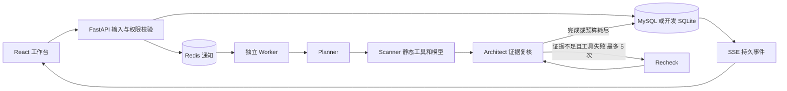

# CodeSentinel V1 架构与接管导航

## 实际任务路径

图有复审回边，因此是 LangGraph 状态图。`app.orchestrator.build_graph` 定义节点、条件路由和退出；`app.worker.run_once` 是实际调用入口。任务与事件由 `app.storage.Store` 持久化，LangGraph 内部状态不单独设检查点；Worker 重启会从任务源文重跑。复审计数和 Worker 失败重试是两种不同的动作。

## 先读这些函数

1. `app.main.submit_job`：登录、项目归属、输入限制与 Redis 可用性。
2. `app.storage.Store.create_job`、`claim`、`finish`：任务状态、源码哈希与版本一致性。
3. `app.worker.run_once`：领取任务、运行图、保存报告或失败。
4. `app.orchestrator.build_graph`：Planner、Scanner、Architect、Recheck 及最大 5 次条件回边。
5. `app.tools.run_tools`：AST、Ruff、Bandit、Semgrep 的本地只读调用和覆盖缺口。
6. `app.context.select_context`：按 AST 符号和发现行选取原文，记录行号映射及省略范围。
7. `app.llm.review_source` 与 `architect_review`：两个独立提示词、同一个可配置模型网关。源码与工具证据作为不可信数据进入提示词。
8. `app.review.scan_source`、`adjudicate` 和 `app.verifier.verify_llm_drafts`：Pydantic 交接、行号与引文核验、同根因去重及双维度裁决。
9. `app.main.stream_events`：SSE 补读及断线继续。
10. `app.evaluate` 与 `app.ablate`：回归样本与 A/B/C/D 对照，注意合成数据限制。

## 失败路径

扫描器缺失、超时、非法 JSON 或非正常退出时，`run_tools` 写入 `coverage.gaps`；模型输出不符合契约时丢弃候选并记缺口。关键覆盖缺口存在时报告不会给无条件 `pass`。任务执行异常由 Worker 记录为 `failed` 并在持久事件中说明，服务端堆栈不返回浏览器。只有排队状态允许取消；运行中的任务不强制终止。上传源码只作为文本交给解析器和扫描器，不作为 Python 程序运行。
